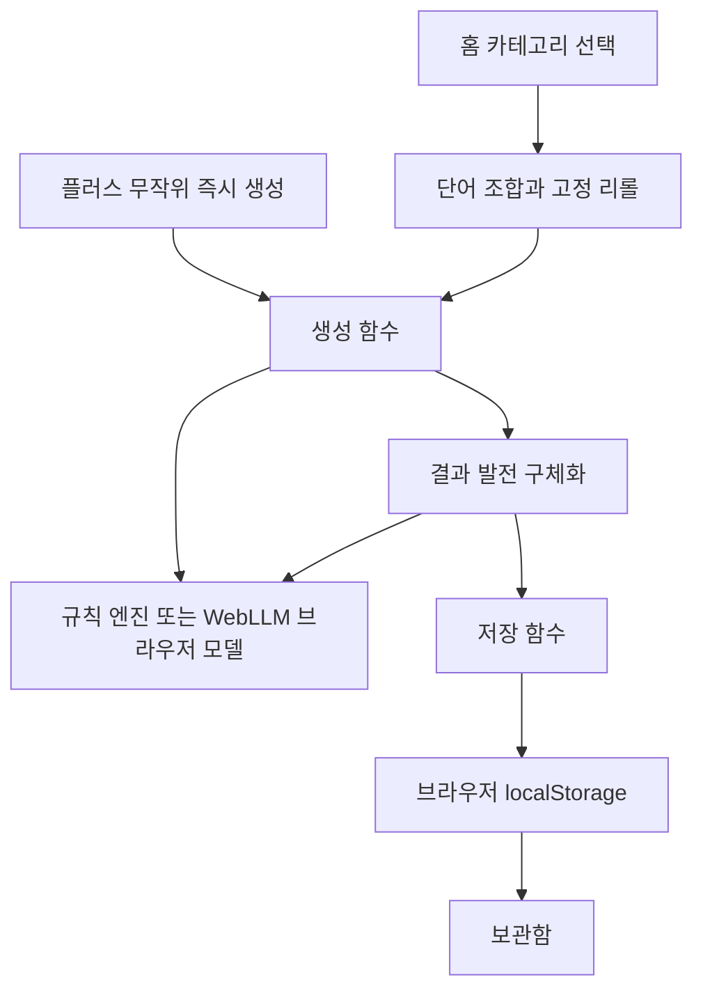

# 아이디어 보조 앱 시연용 개발 기준

2026년 10월 14일 변경 기준입니다. 이전 통합 문서의 서버·API·DB 설계는 이번 교수님 시연 범위에서 제외합니다. 이번 구현은 이 문서를 기준으로 합니다.

## 기술 선택

React·JavaScript·CSS·Vite로 로컬 브라우저에서 실행합니다. 상태 관리는 React 내장 상태로 충분하며 React Native, Fastify, OpenAPI, PostgreSQL, Drizzle, Zod, Zustand, TanStack Query는 이번 실행 버전에 도입하지 않습니다.

## 구성도

외부 AI 모델 파일을 처음 내려받는 요청은 있습니다. 아이디어를 저장하는 API 서버와 데이터베이스는 없습니다. AI 추론은 Web Worker 안의 WebLLM에서 수행합니다.

## 데이터 목록

| 데이터 | 저장 위치 | 내용 |
|---|---|---|
| 카테고리·단어·조건 | 소스 파일 | 카테고리 3개, 카테고리별 소재·방식·분위기 단어 각 12개 |
| 내 단어 | localStorage | 최대 10개, 조합에 최대 2개 적용 |
| 폴더 | localStorage | ID와 이름 |
| 아이디어 | localStorage | 제목·설명·단어·단계·발전 방향·구체화·생성 방식·수정 버전·저장 시각 |
| 마지막 단어 조합 | localStorage | 카테고리·단어 3개·조건 |
| AI 모델 | 브라우저 캐시·메모리 | 초기 다운로드 후 준비해서 사용 |

저장 키는 `idea-assist-demo-v1`입니다. 이전 앱의 자료를 읽거나 수정하지 않습니다.

## 호출 함수 목록

HTTP API 계약은 제외합니다. 앱 내부 함수의 입출력으로 기능을 연결합니다.

| 함수 | 목적 |
|---|---|
| `drawWords` | 단어 3개 추출, 고정 슬롯 유지, 중복 방지 |
| `composeIdea` | 규칙 기반 시연 결과 생성 |
| `developIdea` | 방향별 설명과 실행 단계 변경 |
| `elaborateIdea` | 타깃·문제·기능·첫 실험 초안 |
| `loadModel` | 실제 WebLLM 모델 준비 |
| `modelGenerate` | 실제 모델의 생성·발전·구체화 |
| `validateIdea` | 필드·단계·사용 단어 검증 |
| `saveRecord`, `readLibrary`, `writeLibrary` | 중복 없는 저장과 복원 |
| `validateLibrary` | 가져올 백업 구조 검증 |

## 화면 흐름

홈에서 카테고리를 골라 단어 조합 화면으로 이동합니다. 세 단어 중 최대 2개를 고정하고 나머지를 리롤합니다. 창조 버튼으로 결과를 만들고 방향별 발전이나 구체화를 요청합니다. 이름·폴더를 정해 저장한 후 보관함에서 다시 엽니다.

플러스는 카테고리 선택·조합 확인을 건너뛰고 무작위 카테고리와 단어로 결과 생성을 즉시 시작합니다. 새 결과에서 뒤로 돌아가 단어를 조정할 수 있습니다. 홈과 보관함은 고정 탭입니다. 저장되지 않은 결과가 있으면 화면 이동 전 안내합니다.

## 결정 기록

| ID | 결정 | 이유 |
|---|---|---|
| DEMO-001 | 서버·API 계약·DB 제거 | 교수님 앞에서 바로 실행할 작은 구현에 집중 |
| DEMO-002 | 브라우저 앱으로 시연 | PC 화면에서 실행하고 기기 폭에 맞춰 반응형으로 확인 |
| DEMO-003 | localStorage 저장 | 새로고침 후에도 동일 브라우저의 보관함 유지 |
| DEMO-004 | 간편 시연과 실제 AI 명확히 표시 | 규칙 결과를 AI 추론 결과로 오인시키지 않음 |
| DEMO-005 | 실제 AI는 WebLLM | API 키·별도 서버 없이 브라우저 GPU로 모델 실행 |
| DEMO-006 | 플러스 즉시 생성 | 사용자가 요청한 선택 생략 흐름 적용 |
| DEMO-007 | 아이디어 참조 제거 | 홈·생성·보관함 3가지 행동에 집중 |
| DEMO-008 | 기존 서버·데이터 파일은 미사용 상태로 보존 | 기존 작업과 자료를 잃지 않도록 유지 |

## AI의 한계

실제 시연 검사에서 경량 모델은 생성과 발전의 추론 응답을 반환했지만 내용 반복과 연결 부족이 확인됐습니다. 구체화 요청은 응답 검증에 실패했습니다. 따라서 실제 AI 모드는 실험 기능으로 표시하고, 기능 흐름을 보여주는 기본 간편 시연과 구분합니다. 고품질의 AI 창작 시연이 완성됐다고 주장하지 않습니다.

실제 모델은 Qwen2.5 0.5B의 경량 모델입니다. 창작 초안을 생성할 수 있으나 한국어와 구체성은 큰 클라우드 모델보다 제한적입니다. 초기 다운로드와 GPU 호환성이 필요하므로 발표 전에 준비해야 합니다. 기기 환경이 맞지 않으면 실제 모델 추론은 실행할 수 없습니다. 간편 시연은 그 상황에서도 앱 흐름을 확인하는 기능이며 AI 호출을 대체했다고 설명하지 않습니다.

## 시연 검증

단어 고정 위치 유지, 중복 제거, 발전 내용 변화, 구체화, 이름·폴더 저장, 보관함 재조회, 새로고침 후 보존을 확인합니다. 자동 테스트는 `pnpm.cmd test`, 화면 실행은 `pnpm.cmd dev`입니다. 최신 실제 브라우저 검증 결과는 `시연_검증결과.md`에 기록합니다.
